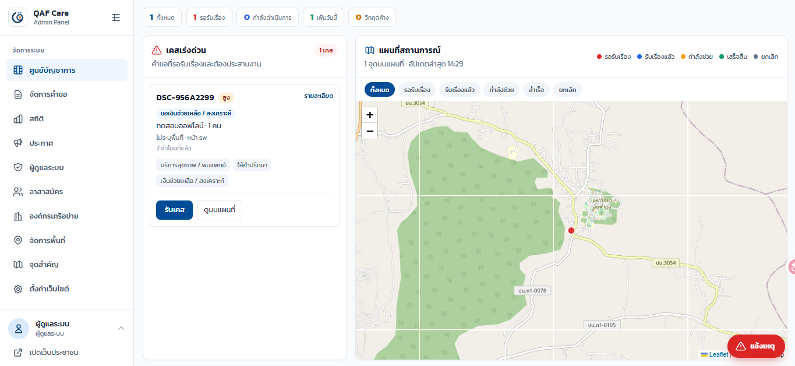
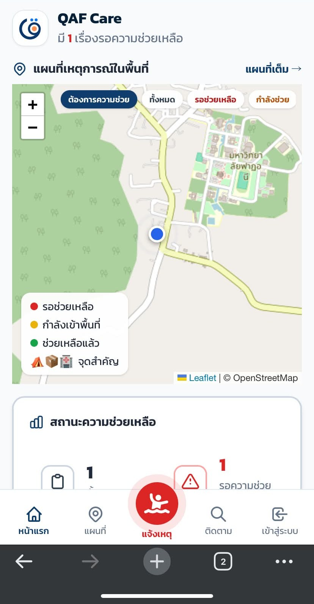
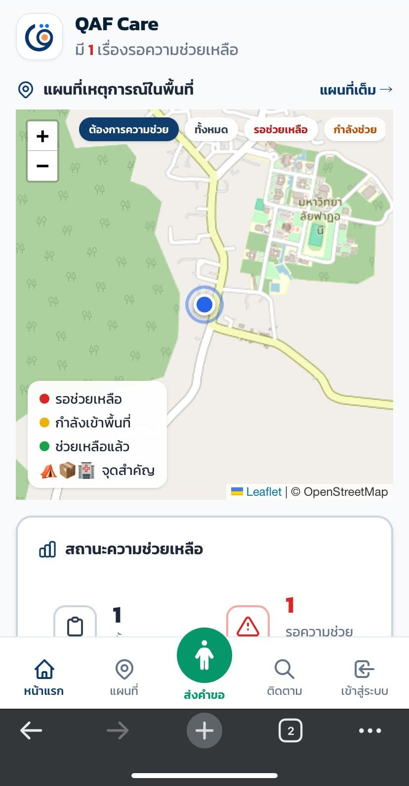

# Dlite

**ระบบประสานงานช่วยเหลือและบรรเทาทุกข์** — ประชาชนแจ้งเหตุ/ส่งคำขอ อาสาสมัครรับเคส และผู้ดูแลบริหารจัดการได้ในที่เดียว รองรับทั้งงานภัยพิบัติ/น้ำท่วม และงานบรรเทาทั่วไป (Relief)

*Lightweight disaster & relief coordination system — Pure PHP + SQLite, mobile-first, self-hosted.*

[](https://php.net)
[](https://sqlite.org)
[]()

## หน้าจอระบบ

| แดชบอร์ดผู้ดูแลระบบ | โหมดภัยพิบัติ (มือถือ) | โหมดบรรเทา (มือถือ) |
|:---:|:---:|:---:|
|  |  |  |

## คุณสมบัติหลัก

### ประชาชน
- แจ้งเหตุ / ส่งคำขอผ่านมือถือ — เลือกสถานการณ์เป็นการ์ด สะดวกและเร็ว
- อัปโหลดรูปประกอบ + ระบุพิกัด GPS อัตโนมัติ
- ติดตามสถานะเคสด้วยรหัส + ไทม์ไลน์อัปเดต
- ยืนยันปิดเคสเองเมื่อได้รับความช่วยเหลือแล้ว
- ดูประกาศและเหตุการณ์บนแผนที่สด

### อาสาสมัคร
- **สมัครสมาชิกออนไลน์** — กรอกทักษะ อุปกรณ์ และองค์กรได้เลย (รอแอดมินอนุมัติก่อนใช้งาน)
- ตั้งสถานะ พร้อมงาน / ติดภารกิจ
- รับเคสจากคลังงานกลาง (claim) อัปเดตสถานะ + แนบรูปหน้างาน
- เสนอความช่วยเหลือ โอนย้ายเคสระหว่างอาสา
- จดจำการเข้าสู่ระบบ 30 วัน

### ผู้ดูแลระบบ
- **ศูนย์บัญชาการ** — ภาพรวมเคสเร่งด่วน + แผนที่สด
- **หน้าสถิติ** — กราฟเคสรายวัน สถานะ จังหวัด ความเร่งด่วน (Chart.js)
- จัดการคำขอ: กรอง มอบหมาย เปลี่ยนสถานะ ปิดเคส ลบ ส่งออกข้อมูล
- จัดการอาสาสมัคร: อนุมัติ ระงับ ลบ — พร้อมทักษะ/อุปกรณ์
- จัดการองค์กรเครือข่าย, จุดสำคัญ (POI), พื้นที่, และประกาศ
- **จัดการบัญชีหลายคน** — admin หลายบัญชี + viewer (ดูอย่างเดียว)
- **White-label** — เปลี่ยนชื่อแอปและโลโก้ได้จากหน้าตั้งค่า
- **2 โหมดการทำงาน** — ภัยพิบัติ/น้ำท่วม ↔ งานบรรเทาทั่วไป สลับได้ทันที

### ระบบ
- 3 บทบาท: `admin` / `volunteer` / `viewer` พร้อมสิทธิ์แยกชัดเจน
- CSRF ทุกฟอร์ม, login throttle (5 ครั้ง/5 นาที), remember-token แบบ hash
- SQLite WAL mode + file cache — เบาและเร็วบน shared hosting
- Progressive enhancement — ฟอร์มใช้งานได้แม้ JavaScript ปิด
- Draft ฟอร์มบันทึกใน localStorage + queue ตอนออฟไลน์

## Tech Stack

| Layer | Technology |
|---|---|
| Backend | PHP 8.2+ (Thin MVC, no framework) |
| Database | SQLite (WAL mode) — ไฟล์เดียวจบ |
| Frontend | Tailwind CSS + Vanilla JS + Font Awesome |
| Map | Leaflet + OpenStreetMap |
| Charts | Chart.js |

## ความต้องการ

- PHP 8.2+ (แนะนำ 8.2/8.3)
- Extensions: `pdo_sqlite`, `sqlite3`, `fileinfo`, `gd` (ไม่มีก็ใช้ได้ แต่รูปจะไม่ถูกบีบอัด)
- Apache + `mod_rewrite` (หรือตัว router อื่นที่รองรับ rewrite)
- **ไม่ต้องใช้** Composer, Node.js, MySQL

## การติดตั้ง

### Shared Hosting (Apache)

1. อัปโหลดทั้งโฟลเดอร์ขึ้น hosting ผ่าน FTP
2. `index.php` อยู่ที่ root ของโปรเจกต์แล้ว — ไม่ต้องย้าย Document Root
   - อัปเข้าโฟลเดอร์ย่อย เช่น `public_html/flood/` → เปิด `https://yourdomain.com/flood/` ได้เลย
3. ให้สิทธิ์ `storage/` และ `uploads/` เป็น writable (755/775)
4. เปิดเว็บ — ระบบสร้างฐานข้อมูล SQLite + migrations อัตโนมัติ

### Local (XAMPP / Laragon)

วางโฟลเดอร์ใน `htdocs` แล้วเปิด `http://localhost/dlite/` ได้เลย

### บัญชีเริ่มต้น

| Role | Phone | Password |
|---|---|---|
| Admin | `0800000000` | `admin123` |

> ⚠️ **เปลี่ยนรหัสผ่านทันที** หลังเข้าสู่ระบบครั้งแรก — ไปที่ `/password`

หลังติดตั้งแนะนำ:
1. เข้า `/admin/settings` — ตั้งชื่อแอป โลโก้ และเลือกโหมด (ภัยพิบัติ/บรรเทา)
2. เพิ่มบัญชีแอดมิน/ผู้ดูเพิ่มที่ `/admin/users`
3. เปิดรับสมัครอาสาสมัคร — ประชาชนสมัครเองที่ `/register` แล้วแอดมินอนุมัติที่ `/admin/volunteers`

## โครงสร้างโปรเจกต์

```
dlite/
├── index.php               # Front controller + routes
├── .htaccess
├── landing/                # Landing page (static, สำหรับ GitHub Pages)
│   ├── index.html
│   └── assets/             # screenshots
├── assets/                 # CSS/JS static
├── uploads/                # รูปที่อัปโหลด (ต้อง writable)
├── app/
│   ├── config.php
│   ├── Controllers/        # Home, Need, Map, Track, Volunteer, Auth, Admin
│   ├── Models/             # User, Need, Volunteer, Organization, Setting, ...
│   ├── Views/              # layouts/, needs/, admin/, volunteer/, auth/
│   └── Core/               # Auth, Database, Router, Helper, View, Cache
└── storage/                # database.sqlite + cache + logs (ต้อง writable)
```

## Routes หลัก

| Method | Path | คำอธิบาย |
|---|---|---|
| GET | `/` | หน้าแรก — แจ้งเหตุ/แผนที่ |
| GET/POST | `/request` | ฟอร์มแจ้งเหตุฉบับเต็ม |
| GET | `/track` | ติดตามเคสด้วยรหัส |
| GET | `/map` | แผนที่สาธารณะ |
| GET | `/register` | สมัครอาสาสมัคร (รออนุมัติ) |
| GET/POST | `/login` `/logout` `/password` | Auth |
| GET | `/volunteer` | พื้นที่ทำงานอาสา |
| GET | `/admin` | ศูนย์บัญชาการ |
| GET | `/admin/requests` | จัดการคำขอ (+ export, bulk) |
| GET | `/admin/volunteers` | จัดการอาสาสมัคร |
| GET | `/admin/organizations` | องค์กรเครือข่าย |
| GET | `/admin/stats` | สถิติ + กราฟ |
| GET | `/admin/users` | จัดการบัญชี admin/viewer |
| GET/POST | `/admin/settings` | ตั้งค่าแบรนด์/โหมด |
| GET/POST | `/admin/pois` `/admin/areas` `/admin/announcements` | POI, พื้นที่, ประกาศ |

ดู routes ทั้งหมดได้ที่ `index.php`

## การปรับแต่ง

- **ชื่อแอป/โลโก้/โหมด**: หน้า `/admin/settings` (ไม่ต้องแก้โค้ด)
- **ตัวเลือกทักษะ/อุปกรณ์อาสา**: `Volunteer::SKILLS_*` / `EQUIPMENT_*` ใน `app/Models/Volunteer.php`
- **ตัวเลือกสถานการณ์/ความต้องการ**: `Helper::scenarioLabels()` / `needTypes()` ใน `app/Core/Helper.php`
- **สี/ฟอนต์**: Tailwind config ใน `app/Views/layouts/*.php`
- **ขนาดอัปโหลดรูป**: `UPLOAD_MAX_SIZE` ใน `app/config.php`
- **Cache TTL**: `CACHE_TTL` ใน `app/config.php`

## Offline / On-premise

ระบบออกแบบให้ self-host ได้เต็มรูปแบบ:

- ฐานข้อมูลเป็นไฟล์ SQLite เดียว — backup/ย้ายเครื่องด้วยการ copy ไฟล์
- ไม่พึ่ง cloud service — deploy ใน LAN ของหน่วยงานได้
- ฝั่งผู้ใช้: draft ฟอร์ม + queue การส่งบันทึกใน localStorage เมื่อออฟไลน์
- (หมายเหตุ: ไอคอนฟอนต์และแผนที่ tile โหลดจาก CDN — ระบบยังทำงานได้ถ้าเน็ตหลุด แต่ UI อาจไม่สมบูรณ์)

## Security

- Passwords hashed ด้วย `password_hash()` (bcrypt)
- Remember-token เก็บเฉพาะ hash ใน DB, cookie HttpOnly + SameSite
- CSRF token ทุก state-changing request
- Login throttle + account lockout
- Admin-only actions ตรวจสิทธิ์ทุก endpoint (`Auth::requireAdmin()`)
- Upload ตรวจชนิดไฟล์ + resize/re-encode รูปฝั่ง server

## License

Open source สำหรับใช้งานในงานบรรเทาทุกข์และงานด้านสังคม — แนะนำเพิ่มไฟล์ `LICENSE` (เช่น MIT) ก่อน publish สู่สาธารณะ

---

<p align="center">พัฒนาด้วย ❤️ เพื่อสังคม</p>
